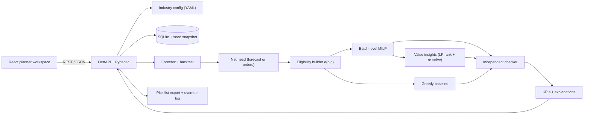

**Problem Statement 2: Distribution Intelligence & Inventory Optimization Engine**

# SahiSupply — Product Requirements Document (v5)

*Right Product. Right Place. Right Time.*
**Explainable, expiry-aware distribution planning for Indian grocery, food and pharmacy networks**

> **Status.** This is a plan for a 24-hour build. Every number in Sections 4–10 is a **design setting or a target**, not a measured result. The prototype runs on synthetic data we generate ourselves. Problem statistics come from the sources listed under **References**. Section 2.4 reports only results we have actually collected.

---

## 0. At a Glance

| | |
|---|---|
| **Problem** | Regional distributors decide each week how to split limited stock, batch by batch, across warehouses and outlets, mostly in spreadsheets. Outlets run out while stock sits elsewhere, and medicines and food expire in the wrong place. At the **market and distribution stage alone**, about **3–3.5%** of guava and tomato is lost [3]. Some public facilities have **under half** of their essential medicines in stock [4], and **most facilities** in a 7-state study reported stockouts of diabetes and hypertension medicines [5]. |
| **User** | The **distribution planner**, who must produce a defensible plan every week. |
| **Beachhead** | **Push networks**: pharmacy chains, hospital and clinic networks, and food commissaries, where the distributor decides what each outlet receives. Order-driven kirana networks are served in **order-rationing mode** (Section 1.4). |
| **Solution** | Forecast or orders → net need → **batch-level optimization** with shelf life checked on arrival → **independent checker** → **why / why-not explanations** → fair comparison against a spreadsheet-style baseline. |
| **What's new** | Expiry handled *inside* the optimizer; a "why not that warehouse?" answer for every line; **measured value of one more unit of stock, capacity or a fridge** (₹ of net margin, or units of critical medicine); India-specific disruption scenarios; one engine for three industries via typed rule templates. |
| **North-star KPI** | **Fill rate under disruption (S1–S3) with zero rule violations**, against the baseline on identical data. |
| **Proof we will show** | 0 rule violations across 100 random seeds; fill rate ≥ baseline + 5 percentage points in ≥ 2 of 3 disruption scenarios, reported **with and without** the contested-supply pattern; full demo in 3 minutes. |
| **Feasibility** | 48 hours of P0 work against 56 person-hours, leaving an **8-hour (14%) buffer**, 2 hours per person (Section 9.1). Stretch work starts only after the hour-14 gate. |

**Where each judging criterion is answered:**

| Criterion | Sections | One-line answer |
|---|---|---|
| Problem Definition & Empathy | 1, 2 | Distribution-stage allocation is decided by hand and checked late; we target the planner who must defend it, and test six falsifiable hypotheses. |
| Technical Architecture & Feasibility | 5, 6, 9 | A batch-level MILP with an independent checker, built in 48 budgeted hours with an 8-hour buffer and a five-step cut ladder. |
| Feature Scope & Prioritization | 4 | 11 P0 items with acceptance tests, 6 ranked P1 items, and a never-cut list. |
| Innovation & Differentiation | 6.6–6.8, 7 | Three domains on one platform, an interactive workspace with charts (plus a network map as a stretch goal), and AI demand prediction with backtested accuracy, all backed by a trust layer no comparable tool offers at this setup cost. |
| Structure & Measurable KPIs | 8 | One north-star KPI, numeric targets for every outcome, and a pass/fail correctness gate. |

---

## 1. Problem & Evidence

> **Problem definition:** Allocation at the distribution stage (which batch goes to which outlet) is decided by hand, one warehouse at a time, with expiry checked late. This causes avoidable stockouts and expiry in exactly the networks where shortages matter most.

### 1.1 Why planning fails today

| Root cause | On the ground |
|---|---|
| **Warehouses plan alone** | Spare stock in one warehouse never reaches an outlet that another warehouse cannot serve. |
| **Plans look backwards** | Orders follow last week's sales, so festival spikes are noticed only after shelves are empty. |
| **Rules live in people's heads** | Expiry, minimum shelf life on arrival and cold-storage needs are checked by hand, often after dispatch. |
| **No fair test** | No one can tell whether a plan was good or merely acceptable. |

### 1.2 Size of the problem

| Relevance | Industry | Evidence | Source |
|---|---|---|---|
| **Directly addressable** | Food / Grocery | Losses at the **market/distribution stage**, e.g. 3.46% for guava and 3.25% for tomato | NABCONS, as reported [3] |
| **Directly addressable** | Pharmacy | About **₹48,000 crore a year** of pharmaceutical value lost; government stock expiry and overstocking are among the named causes | Industry report [6] |
| **Shows it is fixable** | Pharmacy | After a supply-chain redesign in Uttar Pradesh, availability at district warehouses rose from about **40% to about 100%** | [7] |
| **Cost of a stockout** | Pharmacy | Essential-medicine availability of **45.2%** in Punjab public facilities (WHO benchmark: 80%); some categories averaged **186–231 out-of-stock days** | PGIMER study [4] |
| **Cost of a stockout** | Pharmacy | **Most public facilities reported stockouts** of diabetes and hypertension medicines (19 districts, 7 states) | ICMR study [5] |
| **Cost of a stockout** | Retail (global) | About **8.3%** of items out of stock in physical stores; about **40% of shoppers** facing a stockout postpone or buy elsewhere | [8], [9] |
| Context (mostly farm level) | Food / Grocery | **7.36 million tonnes of fruit** and **11.97 million tonnes of vegetables** lost each year after harvest, worth about **₹29,545 crore and ₹27,459 crore** | [1], [2] |

**Scope note.** SahiSupply addresses only the **distribution-stage** share of these losses: allocation, expiry and freshness on arrival. Public-sector stockouts [4][5] also have procurement and funding causes that better allocation cannot fix; we cite them to show what a stockout costs, and [7] to show that supply-chain redesign, not only more funding, can close the gap. The retail figures are global benchmarks, because we found no reliable India-specific rate.

### 1.3 What is specific to India

- **Fragmented networks.** A long tail of kirana stores, chemists and clinics, plus a few large accounts.
- **Monsoon closures** that cut off whole regions for days.
- **Festival spikes** in grocery and food demand.
- **Uneven cold storage** at clinics and restaurants.

The scenario library (6.4) is built around these four realities.

### 1.4 The decision we optimize: push and pull networks

| Network type | Who decides what an outlet receives | Need source | SahiSupply's job |
|---|---|---|---|
| **Push** (beachhead): pharmacy chains, hospital and clinic networks, food commissaries | The distributor | Forecast-based net need (6.1) | Allocate batches to meet each outlet's need |
| **Pull**: kiranas, independent chemists | The outlet, by placing orders | Open orders | **Ration** scarce or short-dated stock across orders when supply is below orders; forecasts flag shortfalls before they arrive |

The industry config sets `need_source: forecast | orders`. The optimizer, checker and explanations are identical in both modes; only the need q(d,p) changes.

---

## 2. Users & Validation

> **Empathy:** We design for the planner who carries the blame for a stockout, and we treat every belief about that planner as a hypothesis with a stated way to be wrong.

### 2.1 Primary persona: the Distribution Planner

> **Ritesh, 31, planner at a regional distributor in Maharashtra** *(illustrative archetype)*. He serves about 200 pharmacies and clinics from 5 warehouses and spends Monday mornings matching stock to need in Excel. Near-expiry batches reach him over WhatsApp, often after loading. In the monsoon, he re-plans by phone.

**Job to be done:** *"When I plan this week's dispatches, I want a plan I can trust and defend, so outlets don't run out, nothing expired leaves the warehouse, and I can explain every decision to my manager."*

**Demo scale.** The demo uses a 12-outlet slice of one region; the stress test uses 48 outlets (5.5); the regional design covers 2,000.

### 2.2 Secondary personas

| Person | Decides | Pain | SahiSupply gives them | Priority |
|---|---|---|---|---|
| Supply Chain Manager | Approves plans; reacts to disruptions | Cannot test a crisis in advance | Baseline comparison, scenarios, value insights | P0 |
| Warehouse Manager | Which batches to pick | Finds near-expiry stock too late | Pick list in earliest-expiry-first (FEFO) order; expiry-risk list | P0 |
| Shop / Pharmacy Manager | Is the delivery enough? | Short-dated or short deliveries | Hindi/Marathi WhatsApp dispatch note | P1 |

### 2.3 Hypotheses we test

| ID | Hypothesis | We are wrong if… | Then we… |
|---|---|---|---|
| H1 | Planners spend **2+ hours a week** on allocation | Most report < 30 min | Reposition as an expiry-and-disruption checker |
| H2 | Near-expiry stock is often found **after dispatch** | Most catch it before loading | Lead with stockouts, not freshness |
| H3 | Trust requires **explaining the plan to a manager** | Users approve plans without opening explanations | Collapse explanations; promote the comparison view |
| H4 | Cost vs. shortage priority **differs by industry** | All industries rank them the same | Use one global weight |
| H5 | Outlet staff prefer **regional-language** notes | Most prefer English | Drop the Hindi/Marathi notes |
| H6 | Pull-network distributors face real allocation decisions **when supply is short** | They report that every order is filled in full | Drop order-rationing mode; focus on push networks |

### 2.4 Validation plan and log

| Method | When | Target | Instrument |
|---|---|---|---|
| Interviews | **Before the event**, plus hours 0–9 if needed | 3–5 calls: a pharmacy-chain distributor, a food/FMCG distributor, a clinic store-keeper | 5 questions: current process and weekly time; last stockout or expiry and its cause; what makes a plan trustworthy; cost vs. shortages; preferred language |
| Survey | Before the event to hour 12 | ≥ 10 responses | 6-item Google Form: role; weekly planning hours; stockout frequency; when expiry is found; tool used today; priority ranking |
| Early usability test | Hours 9–12 | 2 peers | Clickable mocks; tasks T1–T2 |
| Final usability test | Hours 14–17 | 2–3 participants | Tasks T1–T3 (Section 8.4) and the SUS questionnaire |

**Validation log.** Each result is recorded in the repository (`validation/log.md`) with source, number of respondents, finding, hypothesis affected and product change, and is shown in the demo. This document is written before data collection, so it states no findings: results are reported as collected and never estimated. If no practitioner is reachable, the pitch says so and the usability test is labelled "peer test".

---

## 3. One Engine, Three Industries

Each industry is a **YAML file** that selects rules from a fixed library of **typed templates**. No free-form code runs from configs, so a new industry means a new file, not new code.

| Template | Effect | Parameters |
|---|---|---|
| `min_life_on_arrival` | **Blocks** a batch→outlet pair if the shelf life left on arrival (expiry − today − lead time) is below a threshold | days, or % of total shelf life |
| `storage_match` | **Blocks** chilled or 2–8 °C products from outlets without matching storage | storage classes |
| `shortage_weight` | **Raises the penalty** on shortages of a product class | weight per class |
| `fefo` | Prefers earliest-expiry batches (bounded tie-break) | on/off |
| `min_fill_floor` *(P1)* | **Equity guardrail**: every outlet gets at least a minimum share of its need, when supply allows | floor %, class |

| | A. Grocery | B. Food Distribution | C. Pharmacy |
|---|---|---|---|
| Delivers to | Kirana stores, supermarkets | Distributors, restaurants | Pharmacies, clinics, hospitals |
| Need source | `orders` (rationing mode) | `forecast` | `forecast` |
| P0 rules | **G1** `fefo` + `min_life_on_arrival` ≥ 3 days | **F1** `min_life_on_arrival` ≥ 40% of shelf life | **C1** `min_life_on_arrival` ≥ 90 days; **C2** `shortage_weight` critical = 10 |
| P1 rules | — | **F2** `storage_match` (chilled) | **C3** `storage_match` (2–8 °C); **C4** `min_fill_floor` 80% |
| Service level | 90% (z = 1.28) | 90% (z = 1.28) | 98% critical (z = 2.05); 95% standard (z = 1.65) |
| Headline KPI | Fill rate; expiry-risk units | Fill rate; freshness on arrival | Critical shortage units; 0 blocked units shipped |

```yaml
industry: pharmacy
planning: { review_period_days: 7, need_source: forecast }
rules:
  - { id: C1, template: min_life_on_arrival, params: { min_days: 90 }, status: active }
  - { id: C2, template: shortage_weight, params: { weights: { critical: 10, standard: 1 } }, status: active }
  - { id: C3, template: storage_match, params: { classes: ["2-8C"] }, status: planned }
```

Thresholds are configurable settings, not regulatory requirements. We claim no regulatory compliance.

---

## 4. Scope & Priorities

> **Prioritization:** P0 is the smallest set that proves the core claim (a checked, explainable plan that beats the baseline) and fits in 48 of our 56 person-hours. Everything else is ranked and gated.

| Tier | Meaning |
|---|---|
| **P0 — core demo** | Without it there is no demo. Each item has an automated or scripted test. Budgeted at 48 hours, inside hours 0–14 (Section 9.1). |
| **P1 — ranked stretch** | Started only after the hour-14 gate, strictly in rank order. |
| **P2 — post-hackathon** | Section 10. |

### 4.1 P0 (core demo)

| ID | Feature | Acceptance test | Effort |
|---|---|---|---|
| P0-01 | Config-driven industry switch | Products, outlets, rules, need source and KPIs change; config schema test passes for all 3 industries | 1 h |
| P0-02 | Documented synthetic data generator (5.4) | Same seed → byte-identical data (SHA-256); "Synthetic data" label on every screen; contested-supply pattern switchable on/off | 3 h |
| P0-03 | Forecast with rolling backtest | MAE, RMSE and WAPE shown for seasonal-naive, moving-average and ML models; best chosen per industry | 3 h |
| P0-04 | Net requirement (forecast and orders modes) and risk flags | Matches hand calculation on 3 fixtures per mode; stockout-risk and expiry-risk flags | 2 h |
| P0-05 | Batch-level optimizer with G1, F1, C1, C2 | Solves S0–S3 for Grocery and Pharmacy and S0 for Food; turning off each rule changes the plan in its fixture | 5 h |
| P0-06 | Independent checker and input validation | Recomputes eligibility from raw data; 0 violations over 100 random seeds; bad input → typed error | 4 h |
| P0-07 | Greedy baseline, ₹ impact, scenarios S0–S3 (one click each) | Same data fingerprint for both plans; Δ fill, cost, shortage, expiry risk and ₹ impact shown | 4 h |
| P0-08 | Why / why-not explanations per line and per shortage | Every line shows need components, the chosen source and the reason each alternative was not used | 4 h |
| P0-09 | **"Value of one more unit" insights** (6.6) | Top 5 constraints shown, each value measured by an integer re-solve and reproduced by the checker | 2 h |
| P0-10 | Planner workspace UI | Picker → Run → plan table, KPI cards, comparison, explanation drawer, insights panel; flow ≤ 3 min | 11 h |
| P0-11 | **Plan export and override** | Pick list (CSV and print view) in FEFO order; a planner override requires a reason, is logged, and re-runs the checker before the plan is accepted | 2 h |
| — | Delivery and QA infrastructure | CI green; Docker image builds; property tests and end-to-end tests pass; demo host deployed | 5 h |
| — | Validation fieldwork | Survey sent; interviews and early mock test logged (2.4) | 2 h |
| | | **Total** | **48 h** |

### 4.2 P1 (ranked stretch, from hour 14)

We **expect to finish ranks 1–4** (5.5 h). Ranks 5–6 are true stretch.

| Rank | ID | Feature | Effort | Why | Test |
|---|---|---|---|---|---|
| 1 | P1-01 | **Equity guardrail** (C4, 6.7) | 1 h | Prevents the most serious harm: a remote clinic left without critical medicine | No outlet below the floor while supply allows; cost of fairness shown in ₹ |
| 2 | P1-02 | **Disruption-regret score** (6.8) | 1.5 h | Shows where the network is fragile *before* a disruption | Regret and residual shortfall per scenario and region shown |
| 3 | P1-03 | Map (Leaflet + OpenStreetMap) | 2 h | Makes re-routing visible in the demo | Pins and lines match the plan; list-view fallback |
| 4 | P1-04 | Hindi/Marathi WhatsApp dispatch note | 1 h | Reaches outlet staff where they already work (H5) | Checked by a native speaker; totals match the plan |
| 5 | P1-05 | Rules F2, C3 + scenario S4 (cold-room failure) | 1.5 h | Completes the cold-chain story | Rule tests pass → status "active" |
| 6 | P1-06 | Live "add dairy" config | 0.5 h | Proves the one-engine claim on stage | A new YAML file runs end to end, no code |

### 4.3 Cut ladder (checkpoints at hours 9 and 12)

Items are dropped in this order:

1. All P1 items.
2. Food Distribution removed from the live demo (its config and tests stay).
3. UI simplified: insights panel merged into the explanation drawer; comparison shown as one KPI-delta table (saves about 3 h).
4. ML forecaster replaced by the best baseline forecaster (the backtest is still shown).
5. Insights limited to stock constraints only.

**Never cut:** batch-level optimizer, checker, baseline comparison, explanations, plan export, Grocery and Pharmacy.

---

## 5. Architecture, Deployment, Security & Scale

> **Feasibility:** Every component uses a mature, free library the team can run offline; the riskiest piece (the solver) has a time limit and two fallbacks.

### 5.1 Stack

| Layer | Choice | Why |
|---|---|---|
| Frontend | React, TypeScript, Vite, Tailwind, Recharts | Fast to build; typed API client |
| API | FastAPI + Pydantic | Schemas double as the API contract (OpenAPI) |
| Forecast | pandas, scikit-learn `HistGradientBoostingRegressor` | One global model per industry trains in seconds |
| Optimizer | OR-Tools `pywraplp` + SCIP | Free MILP solver with time limits; LP relaxation for ranking insights |
| Storage | SQLite + versioned Parquet seed snapshot | Single file; the data is tabular |
| Tests | pytest + Hypothesis, Vitest | Property tests on checker invariants |

### 5.2 Components



**Run flow:**
1. Validate the request.
2. Load config and data, and compute the **data fingerprint** (SHA-256).
3. Forecast demand.
4. Compute net need from the configured need source.
5. Build the eligibility matrix e(b,d).
6. Solve the MILP (10 s limit) and the baseline on identical inputs.
7. Run the checker on both plans.
8. Compute insights (6.6), KPIs and explanations.
9. Store the plan with its fingerprint.

A scenario change re-runs from step 3. A planner override re-runs steps 7–9 on the edited plan.

### 5.3 Engineering for real use

| Area | Hackathon (built) | Pilot (designed) |
|---|---|---|
| **Deployment** | One multi-stage Docker image (frontend build + API); `docker compose up`; demo host plus an identical offline laptop copy | `staging` and `pilot` environments in an India-region cloud or on the distributor's own server |
| **CI/CD** | GitHub Actions on every push: ruff, eslint, pytest + Hypothesis, Vitest, Docker build. Merges to `main` deploy an image tagged with the commit SHA | Adds mypy, tsc strict mode, `pip-audit`, `npm audit`; coverage ≥ 80% on planner and checker; manual gate before pilot; one-command rollback |
| **Security** | Synthetic data only; Pydantic size limits; configs schema-checked (no `eval`); CORS restricted; rate limiting; no stack traces in errors | Single sign-on; roles (Planner / Approver / Viewer); approval and override audit log; TLS and encryption at rest; pseudonymized outlet IDs; designed with India's DPDP Act 2023 in mind (no compliance claimed) |
| **Observability** | JSON logs keyed by `plan_id` with stage timings, solver status and MIP gap; `/api/health`; `/api/metrics` (solve time, checker violations, fallbacks, overrides) | Alerts on any checker violation, solves over the time limit, or forecast WAPE drift > 20% |
| **Fallbacks** | Database down → seed snapshot; solver time limit → best plan found with its gap; solver failure → labelled baseline; map down → list view | Same |

### 5.4 Synthetic data (per industry, seed 42)

| Entity | Count | Notes |
|---|---|---|
| Warehouses | 5 | Real city coordinates; outbound capacity; cold storage flag |
| Outlets | 12 | 3 regions (for monsoon scenarios); receiving and cold capacity (0 at some) |
| Products | 15 | Volume, storage class, shelf life, price, unit gross margin; Pharmacy has 5 critical and 4 at 2–8 °C |
| Batches | ~135 | Each product at 3 of 5 warehouses, with 2–4 batches each and staggered expiry |
| Routes | 60 | Distance = haversine × 1.3; lead time = 1 + ⌊km / 350⌋ days; capacity; open flag |
| Sales history | 32,400 rows | 12 outlets × 15 products × 180 days |
| Open orders (Grocery) | 180 | One week of orders drawn from the same demand model |

**Demand model** (published with the code):

> base × weekday factor × trend × promotion uplift × festival uplift, with negative-binomial noise

Because true expected demand is known, we report the **noise floor**: the best error any model could achieve.

**Contested-supply pattern.** Some remote outlets share their only source with nearer urban outlets, which is exactly where one-warehouse-at-a-time planning fails. Because we designed this pattern, every outcome KPI is reported on **two datasets: pattern on and pattern off**, so judges can see how much of the gain depends on it.

### 5.5 Scalability path

| Scale | Size | Approach | Evidence |
|---|---|---|---|
| Demo | 5 × 12 × 15 (≤ 1,620 integer variables) | Single MILP | p50/p95 solve time measured |
| Stress | 10 × 48 × 30 (~13,000 variables) | Single MILP, 10 s limit, best plan + gap | **Measured at hour 12–14** |
| Regional | 20 × 2,000 × 500 | Solve the LP relaxation of the full model to split shared warehouse and route capacity across product groups, then solve each group's MILP in parallel; the checker validates the merged plan | Design |
| Multi-company | Many tenants | Stateless API containers; solve jobs on a queue; Postgres with a tenant ID on every row; nightly forecasts | Design |

---

## 6. Planning Method

### 6.1 Forecast and need

- **Models:** seasonal naive; 28-day moving average; global gradient boosting with lags (7/14/28), weekday, promotion, festival and IDs.
- **Backtest:** rolling origin, **4 folds × 14 days** (days 125–180).
- **Selection:** lowest **WAPE**.
- **σ:** standard deviation of daily backtest errors, floored at 1 unit.

**Forecast mode** (push networks). With review period R = 7 days and shortest lead time L_d:

> **q(d,p) = max(0, Σ forecast over R + L_d days + z·σ·√(R + L_d) − U(d,p))**

**U(d,p)** counts only on-hand units that pass the rules and **do not expire within R + L_d days**. In-transit stock is assumed to be zero; this is a stated limitation.

**Orders mode** (pull networks). q(d,p) = open order quantity. The forecast still runs and raises a shortfall flag when next week's forecast need exceeds eligible supply.

### 6.2 Optimization model (one cycle)

**Eligibility:** e(b,d) = 1 only if the warehouse and route are open, storage matches, and **shelf life on arrival** meets the rule. Variables exist only for eligible pairs.

**Decision variables:**
- x(b,d) ∈ ℤ≥0 — units of batch *b* sent to outlet *d*
- u(d,p) ≥ 0 — shortage

> **min Σ c·x + Σ π·u + ε Σ r_b·x**

| Term | Meaning |
|---|---|
| c | Unit delivery cost |
| π(p) | Shortage penalty = class weight × (m_p + s_p). **m_p** is the unit gross margin (₹, from data); **s_p** is a service-level penalty (a policy setting, default chosen so that π exceeds the largest unit delivery cost, so any eligible shortage is filled when capacity allows) |
| ε·r_b | FEFO term. ε·max(r) ≤ 1% of the smallest unit cost, so FEFO only breaks near-ties |

Separating real margin (m) from policy (s) matters for 6.6: only the real part is ever shown as ₹.

**Constraints:**
1. **Batch stock:** Σ_d x ≤ I_b
2. **Need balance:** Σ x + u = q, so nothing is sent beyond need
3. **Warehouse outbound capacity:** Σ v·x ≤ OutCap_w
4. **Outlet receiving capacity:** Σ v·x ≤ InCap_d, with a separate cold-capacity limit
5. **Route capacity:** Σ v·x ≤ RouteCap
6. **Rule blocks:** ineligible pairs have no variable

**Size:** ≤ 1,620 integer variables + 180 shortage variables. Shortage variables guarantee a solution for any valid input; invalid input is rejected before solving.

### 6.3 Greedy baseline (the spreadsheet planner)

Run on **identical data and rules**:
1. Sort (outlet, product) pairs by need, largest first.
2. For each pair, take eligible batches cheapest first, then earliest expiry.
3. Allocate until the need is met, stock runs out, or a capacity limit is reached.

Any gap between the two plans is therefore due to **network-wide allocation**. A separate **rules-off run** shows what the rules themselves prevent.

### 6.4 Scenarios

| ID | Scenario | Change |
|---|---|---|
| S0 | Normal week | none |
| S1 | Festival spike | +40% demand for 5 products at 4 outlets |
| S2 | Warehouse outage | Largest warehouse closed |
| S3 | Monsoon closure | Routes from 2 warehouses into one region closed |
| S4 (P1) | Cold-room failure | One clinic's cold capacity set to 0 |

### 6.5 Checker and explanations

**Checker.** Written by a different team member (role D) from the optimizer (role B), and sharing no eligibility code. It recomputes shelf life from raw dates and verifies:
- constraints 1–5;
- every active rule;
- that on-screen totals match recomputed totals;
- that both plans have the same fingerprint;
- that every displayed insight value matches its re-solve (6.6);
- that any planner override still satisfies all of the above.

A failed plan is never shown as valid.

**Explanations.** For each delivery and each shortage, every other warehouse holding the product gets exactly one reason it was not used:
- **blocked** by a rule, with the value (e.g. "41 days on arrival < 90");
- **closed**;
- **capacity-bound**, naming the constraint;
- **allocated elsewhere**, naming the outlets and the ₹ difference;
- **costlier by ₹Δ per unit**.

The text comes from templates filled with plan numbers. No language model is used.

### 6.6 "Value of one more unit" insights (P0-09)

Duals read after fixing the integer shipments are meaningless, because the fixed constraints no longer contain free variables. We therefore use a two-step method:

1. **Rank.** Solve the **LP relaxation** of the same model (identical eligibility and constraints) and rank binding stock, route and cold-capacity constraints by their dual values.
2. **Measure.** For each of the top 5, re-solve the **integer model** with +k units of that resource (k = max(10, 5% of the current limit)) and report the change per added unit:
   - **Standard products:** ₹ of **net margin recovered** = Δ(delivered gross margin − delivery cost) ÷ k. The policy penalty s is excluded, so the ₹ figure reflects real economics.
   - **Critical medicines:** **critical shortage units avoided** per added unit. No ₹ value is attached to patient access.

Constraints whose re-solve shows no improvement are dropped from the list. Every value is labelled "valid for small changes".

| Binding constraint | Shown as |
|---|---|
| Batch stock at warehouse *w* | "Each extra 10 units of insulin at W2 prevent about N critical shortages" → **procurement or rebalancing signal** |
| Route capacity | "One more vehicle on W1 → Region 3 recovers about ₹Y of net margin this week" |
| Outlet cold capacity | "A fridge at Clinic D9 prevents about N critical shortages per week" |

### 6.7 Equity guardrail (P1-01)

> u(d,p) ≤ (1 − f_min)·q(d,p) + s(d,p), with slack s ≥ 0 penalized at 100π

- f_min = 80% for critical medicines.
- The UI shows the **cost of fairness**: plan cost with the guardrail on, minus plan cost with it off.

### 6.8 Disruption-regret score (P1-02)

For each scenario *k* in S1–S3, the **S0 plan is applied unchanged** to scenario k as follows: shipments using a closed warehouse or route are removed; where a capacity limit is now exceeded, shipments are trimmed smallest-need-first until it holds; the checker then validates the result.

> **Regret(k) = fill rate of the re-optimized plan − fill rate of the applied S0 plan**
>
> **Residual shortfall(k) = need − units delivered by the re-optimized plan**

Both are broken down by region and warehouse. High regret shows where **fast re-planning** pays off; high residual shortfall shows where **re-planning is not enough**, so stock must be pre-positioned before a monsoon.

---

## 7. Differentiation & Innovation

> **Differentiation:** The building blocks are established operations research. The contribution is integrating them for regional Indian distributors, with a trust layer (independent checker, per-line explanations, measured value insights) that comparable tools at this setup cost do not offer.

### 7.1 Capability benchmark

| Capability | Spreadsheet / min-max | Indian distributor ERP & DMS (e.g. Marg ERP, Busy, Tally; Bizom) | Allocation optimizers (e.g. Increff) | Enterprise planning suites (e.g. SAP IBP, Blue Yonder, Kinaxis, o9) | **SahiSupply** |
|---|---|---|---|---|---|
| Network-wide allocation | ✗ | ✗ | ✓ | ✓ | ✓ |
| Batch expiry used *inside* allocation | Manual | Tracks batches and expiry; does not allocate | Varies | Often configurable | ✓ |
| Shelf life checked on arrival | ✗ | Varies | Varies | Varies | ✓ |
| "Why not that warehouse?" for every line | ✗ | ✗ | Varies | Varies | ✓ |
| Independent verification of each plan | ✗ | ✗ | Varies | Varies | ✓ |
| Fair, fingerprinted baseline comparison | ✗ | ✗ | Rare | Rare | ✓ |
| Measured value of one more unit / capacity / fridge | ✗ | ✗ | Varies | Specialist users | ✓ (plain language) |
| India scenarios (festival, monsoon, cold-room) | ✗ | ✗ | Varies | Generic tools | ✓ |
| New industry without code | n/a | Within the product's domain | Implementation project | Implementation project | ✓ (YAML) |
| Setup effort | Low | Low (often already installed) | Medium | High | Low |

Cells summarize each category's typical setup as described publicly; individual products may do more. **The Indian ERP/DMS column is our integration target, not a rival:** distributors already record batches and expiry there, and SahiSupply plans on top of those exports (Section 10.2).

We do not claim to outperform commercial software. The claim is narrower: **a decision engine light enough for a regional distributor, and transparent enough for a planner to defend.**

### 7.2 What is new

#### Three headline innovations

| # | Innovation | What it means | Where it is specified |
|---|---|---|---|
| **A** | **Three domains, one platform** | Grocery, Pharmacy and Food Distribution run on **one shared engine** (forecast, optimizer, checker, explanations). Each domain is a YAML config that selects typed rule templates, so the domains differ only in rules, need source and KPIs, not in code. Switching domains is one click; adding a fourth (e.g. dairy) is one new file. | Section 3; P0-01; P1-06 |
| **B** | **Interactive planner workspace** | One screen with KPI cards, **interactive charts** (forecast vs. actual, baseline vs. optimizer, scenario comparisons), a plan table with a click-through **why / why-not drawer**, a value-insights panel, one-click disruption scenarios, and a **network map** showing warehouses, outlets and re-routed deliveries. Planners explore the plan instead of reading a spreadsheet. | P0-10 (workspace and charts); P1-03 (map, with list-view fallback) |
| **C** | **AI-based demand prediction with measured accuracy** | A machine-learning model (gradient boosting with weekly lags, weekday, promotion and festival features) predicts each outlet's demand. Its accuracy is **measured, not assumed**: a rolling 4-fold backtest compares it with two simple baselines on MAE, RMSE and WAPE; the most accurate model is chosen per domain; and its error is shown next to the noise floor, the best accuracy any model could reach. Target: **≥ 10% lower WAPE than seasonal naive** in every domain. | Section 6.1; P0-03; KPI 8.3 |

#### What no comparable tool at this setup cost offers

| # | Innovation | Why it is rare |
|---|---|---|
| **D** | **"Why not that warehouse?" for every line** | Most planning tools show *what* to ship. SahiSupply also explains, for every delivery and every shortage, why each other warehouse was not used (blocked by a rule, closed, capacity-bound, allocated elsewhere, or costlier), with the exact numbers. A planner can defend every line to a manager in one click. |
| **E** | **Measured value of one more unit, vehicle or fridge** | The plan becomes a ranked list of investments: "one more vehicle on this route recovers ₹Y of margin", "a fridge at this clinic prevents N critical shortages a week". Each value is measured by re-solving the model, not estimated, and medicines are counted in units of patient access, not rupees. |
| **F** | **A plan that checks itself** | An independent checker, written separately from the optimizer, recomputes every rule from raw data. A plan that breaks any rule is never shown as valid. |

A–C are what a planner sees. D–F are why a planner can trust it. The items below are how they are built.

**Algorithmic:**
1. **Lead-time-adjusted, batch-level eligibility inside the MILP.** Freshness is checked on arrival, before allocation, so a plan can never become invalid when actual batches are assigned.
2. **Bounded FEFO.** By construction, earliest-expiry preference cannot override any per-unit cost difference larger than 1% of the smallest unit cost.
3. **Counterfactual explanations** derived from the solved model, for every line and every shortage.
4. **Measured value insights.** LP duals rank candidate constraints; integer re-solves measure the value; real margin is separated from policy penalties, and critical medicines are counted in units, not ₹.
5. **Regret, residual shortfall and a priced equity guardrail** *(P1)*: fragility and fairness made measurable.

**Product:**

6. **Fair, disclosed evaluation:** fingerprinted data, a fully specified baseline, results with and without the contested-supply pattern, and a rules-off run.
7. **Honest forecasting:** model error shown next to the noise floor.
8. **India-first design:** push and pull networks; monsoon, festival and cold-room scenarios; Hindi/Marathi WhatsApp notes.
9. **One engine:** typed rule templates; a new industry is a new file.

**What takes time to copy:** the trust layer (independent checker, property tests, fingerprints) and per-line counterfactual explanations require the model to be designed for them from the start. Over a pilot, the **override log** adds a second advantage: each distributor's recurring corrections become new rule templates and forecast features.

---

## 8. Success Metrics

> **Measurability:** One north-star KPI, numeric targets for every outcome, and a pass/fail correctness gate run before the demo.

All values are **targets**. Actual numbers will be reported even if missed. Synthetic results do not prove real-world impact.

### 8.0 North-star KPI

| KPI | Definition | Target |
|---|---|---|
| **Fill rate under disruption** | Units delivered ÷ units needed, averaged over S1–S3, with 0 rule violations | ≥ baseline + 5 pp in ≥ 2 of S1–S3 (contested-supply pattern on); pattern-off result reported alongside |

### 8.1 Outcomes (optimizer vs. baseline, same data)

| KPI | Definition | Target |
|---|---|---|
| Fill rate (normal week) | Units delivered ÷ units needed in S0 | ≥ baseline |
| Critical shortage units | Units of critical medicine short | ≥ 25% below baseline in ≥ 2 of S1–S3; never above baseline |
| Cost per delivered unit | Delivery cost ÷ units delivered | ≤ baseline + 5% |
| Expiry-risk units | Units left that expire before the next cycle | ≥ 10% below baseline in S0 |
| Freshness on arrival (Food) | Average % of shelf life left on arrival | ≥ baseline |
| Value of rules | Blocked units shipped, rules-off vs. rules-on | Rules-on = 0; rules-off count reported |

### 8.2 Business impact (illustrative, synthetic prices)

| Item | Formula |
|---|---|
| Lost margin avoided | Δ units short × unit gross margin × lost-sale share (default 0.40 from [9], a global benchmark treated as an upper bound) |
| Waste avoided | Δ expiry-risk units × unit cost |
| Net weekly benefit | Lost margin avoided + waste avoided − Δ delivery cost |
| Critical-medicine access | Extra critical units delivered, reported in **units, not ₹** |

**Target:** net weekly benefit > 0 in S0 and in ≥ 2 of S1–S3. The figures are never extrapolated to real companies.

### 8.3 Forecast

| KPI | Target |
|---|---|
| WAPE vs. seasonal naive | ≥ 10% lower, per industry |
| Gap to noise floor | Reported |

### 8.4 Users (usability test, Section 2.4)

With 2–3 participants these are **directional checks, not statistical results**; every participant's raw result is reported.

| KPI | Measure | Target |
|---|---|---|
| T1 — run the weekly plan | Time, unaided | ≤ 60 s |
| T2 — explain why Clinic D7 is short | Correct reason, ≤ 2 clicks | ≥ 2 of 3 participants |
| T3 — re-plan for a monsoon closure | Correctly names the changed lines | ≤ 2 min |
| Task success (T1–T3) | Completed correctly | ≥ 80% of attempts |
| SUS score | 10-item questionnaire, per participant | ≥ 70 each (the commonly cited average is 68) |
| Trust | "Would you approve without re-checking in Excel?" (1–5) | Reported per participant |

### 8.5 Correctness gate (pass/fail before the demo)

| Check | Pass condition |
|---|---|
| Stock, need, capacity, eligibility | 0 violations over 100 random seeds and all scenarios |
| Totals | Screen totals equal recomputed totals |
| Fairness | Identical fingerprints for both plans |
| Determinism | Same seed → same plan |
| Insights | Every displayed value reproduced by the checker from its re-solve |
| Overrides | Every accepted override passes the checker |
| P0 tests | 100% pass |

### 8.6 Performance

| KPI | Target |
|---|---|
| Demo-size solve | p50 < 2 s, p95 < 5 s over 20 runs |
| Stress test (10 × 48 × 30) | Within the 10 s limit; MIP gap ≤ 2% |
| Full demo | ≤ 3 minutes |

---

## 9. Execution Plan

### 9.1 Team and P0 hours budget (hours 0–14)

| Role | P0 work (hours) | Work | Buffer |
|---|---|---|---|
| **A — Data & Forecast** | Config switch 1 · generator 3 · forecast + backtest 3 · net need (both modes) 2 · baseline 2 · plan export 1 | 12 | 2 |
| **B — Optimization** | MILP 5 · scenarios 1 · value insights 2 · explanations 4 | 12 | 2 |
| **C — Frontend** | Workspace UI 9 · real-API integration 2 · export and override UI 1 | 12 | 2 |
| **D — QA, Infra & Validation** | Repo, CI, Docker, OpenAPI mocks 1.5 · **independent checker** 4 · ₹ impact and KPI module 1 · property tests + fixtures 2 · end-to-end tests + deploy 1.5 · validation fieldwork 2 | 12 | 2 |
| **Total** | | **48** | **8** |

**Capacity:** 48 hours of P0 work against 56 person-hours. Each member holds a 2-hour buffer, used first to absorb their own overruns and then released to the most-behind teammate at the hour-9 checkpoint. The cut ladder (4.3) is applied at hours 9 and 12. With 3 people, D's work is split between B and C, the Food demo is cut, and P1 is dropped.

**Rest:** each member takes one staggered 90-minute rest block between hours 14 and 20, never while they are the only owner of an unfinished P0 fix.

### 9.2 Timeline

| Hours | A | B | C | D | Checkpoint |
|---|---|---|---|---|---|
| Before event | — | — | — | Interviews (3–5); survey live | Validation log started |
| 0–1 | Schema + config loader | Toy MILP spike | UI skeleton | Repo, CI, Docker, OpenAPI mocks | Green CI; contract committed |
| 1–5 | Generator + 3 configs | Batch-level MILP | Picker, plan table, KPI cards (mocks) | Checker | Same seed → same data |
| 5–9 | Forecast + backtest | MILP finish; S0–S3; insights start | Comparison + explanation drawer (mocks) | Property tests; fixtures | **Hour 9: buffers reassigned; cut ladder if behind** |
| 9–12 | Net need (both modes); baseline | Insights; explanations | Real API; insights panel | Early mock test; ₹ impact module; end-to-end tests; deploy | One click → checked plan |
| 12–14 | Plan export | Explanations finish | Export and override UI | Full regression; stress-test run; close survey | **Hour 14: P0 gate green** |
| 14–18 | P1-06 dairy | P1-01 equity → P1-02 regret | P1-03 map → P1-04 WhatsApp note | **Final usability test**; validation log | P1 in rank order |
| 18–20 | Buffer | P1-05 if on track | Buffer | Backup demo video | Staggered rest blocks |
| 20–22 | — | Code freeze | — | Final tests on the deployed build | **No features after hour 20** |
| 22–24 | Rehearse ×3 | | | Submit | Demo ≤ 3 min |

### 9.3 Risks

| Risk | Mitigation |
|---|---|
| Little gain over the baseline | Contested-supply pattern and S1–S3; results also shown with the pattern off; S0 reported honestly |
| P0 overruns | 8-hour buffer; cut ladder at hours 9 and 12 |
| Solver slow | Eligibility pre-filter; 10 s limit returns the best plan found with its gap |
| Insight values driven by penalty settings | ₹ values exclude the policy penalty and are measured by integer re-solves; critical medicines reported in units |
| Data judged "fake" | Published generator; labels everywhere; noise floor shown; pattern on/off results |
| No practitioners reachable | Pre-event outreach; peer usability test, labelled as such; empty log disclosed |
| Demo host or internet down | Same Docker image on an offline laptop; backup video |

**Known limitations:**
- Single planning period.
- Straight-line distances with a circuity factor.
- No in-transit stock.
- No vehicle routing.
- Orders mode takes order quantities as given (no negotiation or order splitting).
- Synthetic demand.
- No live integrations.

**Definition of done:** in Grocery and Pharmacy (and Food unless cut), a judge can run a checked plan, compare it with the baseline, open a why/why-not explanation, read the value insights, run a disruption scenario, and export a pick list. All P0 tests pass.

---

## 10. Demo Script & Beyond the Hackathon

### 10.1 Three-minute demo

| Time | Action | The judge sees |
|---|---|---|
| 0:00 | One distribution-stage statistic + one collected validation finding (or, if none, the hypothesis being tested); open Pharmacy | Synthetic-data label; batches with expiry flags |
| 0:20 | Run S0 | Plan, KPIs, checker showing 0 violations, baseline comparison with ₹ impact |
| 0:45 | Click a short insulin line | Why / why-not for every source |
| 1:10 | Open insights | "A fridge at Clinic D9 prevents about N critical shortages a week"; "One more vehicle on W1 → Region 3 recovers ₹Y of net margin" |
| 1:35 | Run S3 (monsoon) | The baseline leaves the remote clinic short; the optimizer re-sources |
| 2:05 | Equity guardrail on *(P1)* | All clinics ≥ 80%; cost of fairness in ₹ |
| 2:25 | Toggle C1 off, then on | Rules-off ships N short-dated units; rules-on ships 0 |
| 2:45 | Switch to Grocery (orders mode); export the pick list | Same engine, different rules and need source; a plan the warehouse can act on |

If a P1 step isn't built, it is skipped and the demo finishes early.

### 10.2 After the hackathon

| Phase | Weeks | What happens | Exit criterion |
|---|---|---|---|
| Shadow mode | 1–4 | One distributor exports anonymized weekly batch and order data from their existing ERP or billing system; SahiSupply plans **alongside** the planner | 4 weekly plans, 0 violations on real data |
| Assisted | 5–8 | Planner edits SahiSupply's plan; every override is logged with a reason | Override rate falling week over week |
| Measured | 9–12 | Compare against the distributor's prior 12 weeks: planner hours, fill rate, critical stockouts, expired write-offs, cost per unit, SUS | Written report, whichever way it comes out |

**Feedback loop:** recurring override reasons become new rule templates or forecast features. Forecast drift and SUS are reviewed monthly.

**Roadmap:**
- **0–3 months:** CSV import wizard for common Indian ERP exports, Postgres, login and approvals.
- **3–6 months:** direct ERP connectors, road distances, multi-period planning with in-transit stock.
- **6–12 months:** vehicle routing, transfers between outlets, robust planning.

**Business model hypothesis:** a per-warehouse monthly subscription, priced between free spreadsheets and enterprise suites, sold as an add-on to the ERP the distributor already uses. Pricing will be validated during the pilot.

---

## References

1. Rajya Sabha, Unstarred Q. 572 (7 Feb 2025), citing the NABCONS 2022 post-harvest loss study. https://rsdebate.nic.in/bitstream/123456789/758453/1/PQ_267_07022025_U572_p312_p312.pdf
2. Lok Sabha, Unstarred Q. 1773 (5 Dec 2024), "Post-Harvest Losses". https://eparlib.sansad.in/bitstream/123456789/2984698/1/AU1773_tyKJYF.pdf
3. FreshPlaza, "India reports high guava and tomato losses". https://www.freshplaza.com/asia/article/9756104/india-reports-high-guava-and-tomato-losses/
4. Medical Dialogues, "Punjab Govt hospitals do not have 50 pc medicines: PGI Study". https://medicaldialogues.in/punjab-govt-hospitals-do-not-have-50-pc-medicines-pgi-study
5. The Week / PTI (3 Jun 2025), ICMR study on diabetes and hypertension medicine shortages. https://www.theweek.in/wire-updates/national/2025/06/03/des106-health-icmr-study.html
6. BioSpectrum India (22 Jul 2026), Primus Partners report on ~₹48,000 crore pharmaceutical value leakage. https://www.biospectrumindia.com/public/news/16/28176/primus-partners-report-highlights-nearly-rs-48000-cr-annual-pharmaceutical-value-leakage.html
7. Frontiers in Public Health (2025), redesign of the public medicines supply chain in Uttar Pradesh. https://www.frontiersin.org/journals/public-health/articles/10.3389/fpubh.2025.1588227
8. Supermarket News, GMA study on online out-of-stocks. https://www.supermarketnews.com/grocery-trends-data/reducing-online-out-of-stocks-critical-for-retailers-says-gma-study
9. Supermarket News, "New GMA study shows rising incidence of out-of-stocks". https://www.supermarketnews.com/mergers-acquisitions/new-gma-study-shows-rising-incidence-of-out-of-stocks
