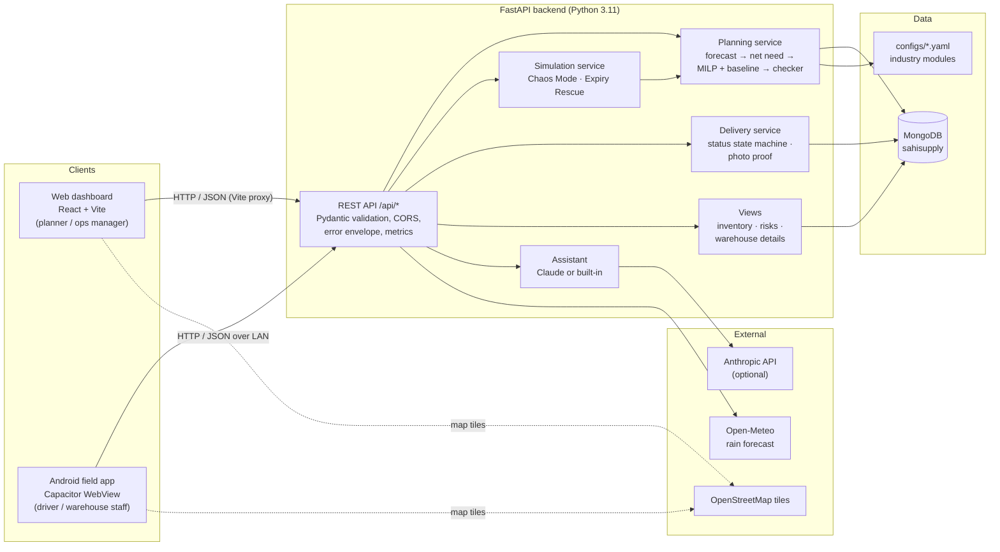
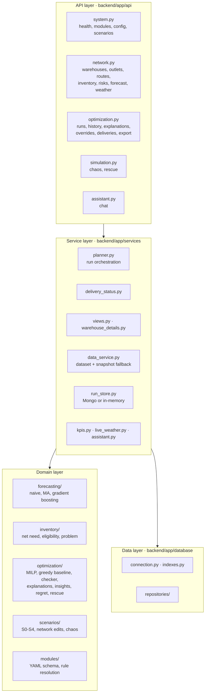
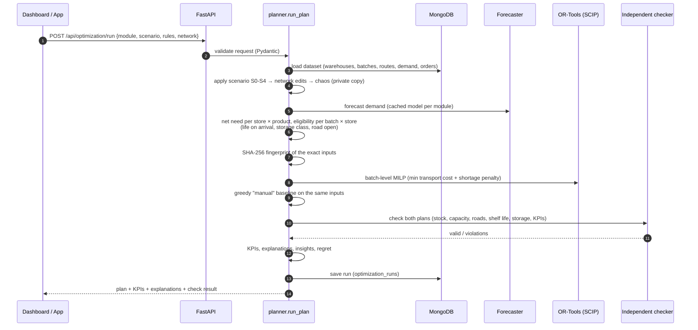
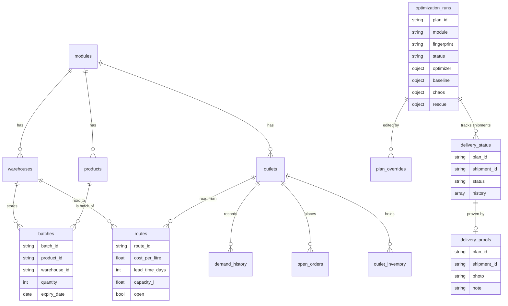
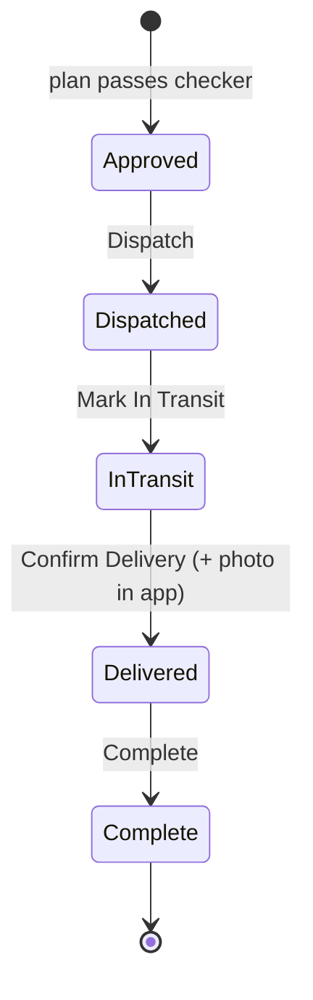
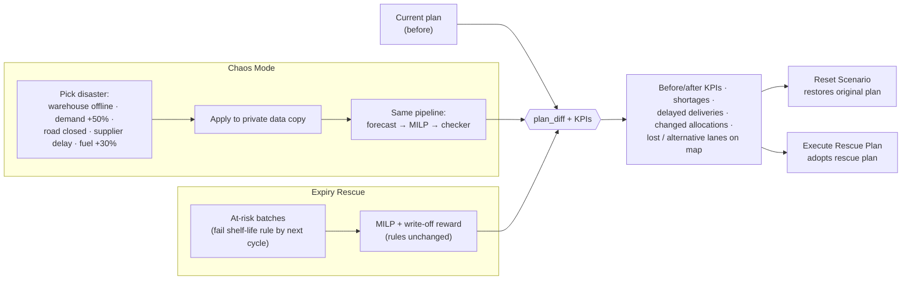
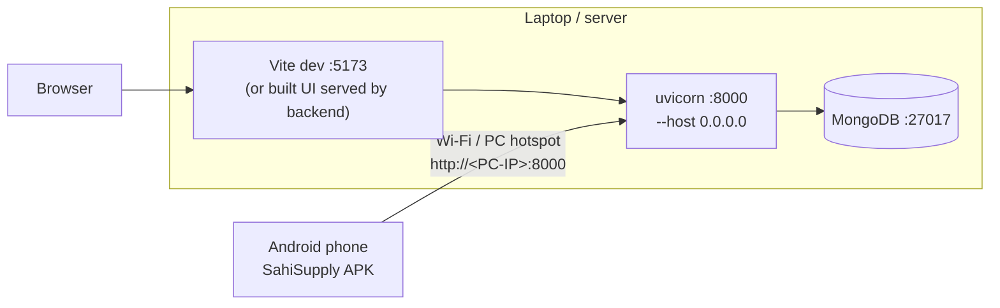

# SahiSupply

<p align="center"></p>

<p align="center"><b>Sahi Stock. Sahi Jagah. Sahi Samay.</b><br/><i>Right stock. Right place. Right time.</i></p>

SahiSupply is an explainable, expiry-aware **distribution-planning platform** for multi-warehouse networks. Every
week it decides **which product batch goes to which store and how much**, while respecting stock, warehouse and
road capacity, cold-chain storage and shelf life **on arrival**. It also handles what happens after planning:
drivers deliver with photo proof, warehouse staff watch expiry alerts, and planners stress-test the network with
controlled disaster simulations.

| | |
|---|---|
| **Web dashboard** (planners, ops managers) | Make the weekly plan, see why each store gets what it gets, run what-ifs, Chaos Mode and Expiry Rescue, track deliveries on an animated map, explore any warehouse in 3D |
| **Mobile field app** (drivers, warehouse staff) | Android app: today's trips, Dispatch → Confirm Delivery with a photo, warehouse expiry/stock alerts, 3D warehouse view |
| **Planning engine** (FastAPI + OR-Tools) | Forecast → net need → batch-level MILP → independent checker → explanations, on fingerprinted data |

One engine serves three industry modules, each defined in YAML (`configs/`):

| Module | Destinations | Need source | Enforced rules |
|---|---|---|---|
| Grocery Retail | kirana stores, supermarkets | open orders (rationing) | G1 ≥ 3 days life on arrival; FEFO tie-break |
| Cosmetics Retail | beauty stores, salons, department stores | forecast | K1 ≥ 30% shelf life on arrival; K2 cool storage for sensitive skincare; K3 FEFO |
| Pharmaceuticals | pharmacies, clinics, hospitals | forecast | C1 ≥ 90 days on arrival; C2 critical shortage weight 10; C3 2-8 °C storage match; C4 80% equity floor (optional) |

> **All operational data is synthetic** (seed 42): warehouses, stock, demand, prices and companies are a sample,
> not any real company's. The only live external data is the **weather forecast** (Open-Meteo). Rule thresholds
> are configurable design settings, not regulatory advice. Chaos Mode is a **controlled simulation**, not
> real-time disruption detection.

Product spec: [`Asteroid_PS2_SahiSupply_PRD.md`](Asteroid_PS2_SahiSupply_PRD.md) (MongoDB replaces the PRD's
SQLite; Cosmetics replaced the PRD's Food Distribution module). More detail: [docs/architecture.md](docs/architecture.md),
[docs/api.md](docs/api.md), [data/README.md](data/README.md), [validation/results.md](validation/results.md).

---

## Contents

1. [System architecture](#1-system-architecture)
2. [Features](#2-features)
3. [Who uses what](#3-who-uses-what)
4. [Tech stack](#4-tech-stack)
5. [Repository layout](#5-repository-layout)
6. [Getting started](#6-getting-started)
7. [Mobile app (Android APK)](#7-mobile-app-android-apk)
8. [API reference](#8-api-reference)
9. [Testing and validation](#9-testing-and-validation)
10. [Demo walkthrough](#10-demo-walkthrough)
11. [Limitations and roadmap](#11-limitations-and-roadmap)
12. [Troubleshooting](#12-troubleshooting)
13. [Credits](#13-credits)

---

## 1. System architecture

### 1.1 High-level view



The web and mobile clients are **one React codebase**: the desktop dashboard lives under `/`, the field screens
under `/m`, and Capacitor packages the same build as an Android app that opens on `/m`. Both talk to the same
FastAPI backend, so a delivery confirmed on a phone shows up on the dashboard and map at once.

### 1.2 Backend layers



### 1.3 Planning pipeline (one run)



**MILP formulation (simplified).** Decision `x[b,d]` = units of batch *b* shipped to store *d* (integer), `u[d,p]`
= unmet need. Minimise `Σ unit_cost·x + Σ π_p·u + ε·FEFO` subject to: batch stock, `Σ x + u = need`, warehouse
outbound capacity, store receiving and cold capacity, road capacity, optional equity floor, and eligibility (only
batches with enough life on arrival and the right storage class have variables at all). π_p (shortage penalty)
is larger than any delivery cost and weighted by criticality, so the solver always prefers shipping to leaving a
store short. Expiry Rescue adds a reward equal to the write-off value for units shipped from at-risk batches.
The **checker shares no code with the optimizer** and re-derives every constraint from raw inputs.

### 1.4 Data model (MongoDB)



| Collection | Contents |
|---|---|
| `modules`, `dataset_meta`, `calendars` | module registry, dataset SHA-256 and planning date |
| `warehouses`, `outlets`, `products`, `batches`, `routes` | the network and stock (per module; routes in contested/uncontested variants) |
| `demand_history`, `open_orders`, `outlet_inventory` | 32,400 demand rows, orders and store stock |
| `optimization_runs` | every plan (normal, scenario, chaos, rescue) with inputs, KPIs, check result, explanations |
| `plan_overrides` | validated manual changes with reason and actor |
| `forecast_runs` | forecast backtest metrics per dataset fingerprint |
| `delivery_status` | shipment status + history (unique on `plan_id, shipment_id`) |
| `delivery_proofs` | proof-of-delivery photo (compressed JPEG data URL) and note |
| `trace_events` | QR scan event log (stage, result, flags, shipment, device, status change) |
| `app_settings` | server-generated QR signing secret (unless `QR_SECRET` is set) |

If MongoDB is down the API keeps working on a labelled **snapshot fallback** and an in-memory run store
(`persisted: false` in responses).

### 1.5 Delivery lifecycle

A **shipment** is one truck trip from one warehouse to one store: `SHP-{warehouse}-{store}` (e.g. `SHP-W1-D2`).
Status only moves forward, one step at a time; the backend rejects anything else (`409 INVALID_TRANSITION`) and
updates are conditional on the status read, so two taps can't both advance it.



### 1.6 Simulations



Stored operational data is never modified. If no feasible plan exists, the response says so and lists remaining
shortages and checker violations; no recovery is claimed.

### 1.7 Deployment (demo setup)



Docker files (`Dockerfile`, `docker-compose.yml`) are provided; Atlas works by setting `MONGODB_URI`.

---

## 2. Features

### Planning and explainability
* **Config-driven industry switch**: Grocery, Cosmetics, Pharmacy from strict YAML (no `eval`).
* **Forecasting**: seasonal naive, 28-day moving average and gradient boosting, chosen by rolling backtest
  (MAE / RMSE / WAPE, noise floor).
* **Net need** in forecast or open-orders mode, with safety stock by criticality.
* **Batch-level MILP** (OR-Tools SCIP) with shelf-life-on-arrival, storage-class, FEFO, critical weighting and an
  optional equity floor; **greedy baseline** ("manual planning") on identical, fingerprinted data.
* **Independent checker** on every plan; invalid plans are labelled, never shown as valid.
* **Why / why-not explanations** for every line and shortage ("road closed", "fridge full", "expires too soon").
* **Smart suggestions**: value of one more unit of capacity (LP duals rank, MILP re-solves measure).
* **Overrides**: manual edits are re-checked; refused with the reason or saved and logged.
* **Scenarios S0-S4** (festival spike, warehouse outage, monsoon closure, cold-room failure) and a
  **network builder** (toggle warehouses/stores, open/close individual roads).
* **CSV / print export** of the pick list in FEFO order.

### Operations
* **Delivery status tracking** with colour-coded badges (Approved, Dispatched, In Transit, Delivered, Complete)
  and action buttons in the delivery table, the map list and the mobile app; dashboard summary of truck trips.
* **Animated network map** (Leaflet): small yellow trucks drive along curved, fading arcs; closed roads are red
  dotted; **select a delivery to highlight only its truck and route in green**.
* **Warehouse popup + 3D warehouse**: click a warehouse for stock, simulated capacity, utilisation, stock-out
  risks and expiring batches; **View 3D Warehouse** opens a lazy-loaded three.js interior themed per industry
  (pallet racking, beauty shelving, GDP shelving with a 2-8 °C cold room), built from that warehouse's real batches,
  with a quarantine cage, loading dock truck, forklift, zone presets and tap-a-shelf details. 2D plan fallback.
* **Live weather** (Open-Meteo): 7-day rain forecast per site; roads at heavy-rain sites can be closed and re-planned.
* **Ask SahiSupply** assistant on every page, grounded in the current plan (Claude when `ANTHROPIC_API_KEY` is set,
  otherwise a built-in assistant).

### Resilience and waste
* **⚡ Chaos Mode**: *SIMULATE DISASTER* on the dashboard with five disruptions, user-chosen warehouse/road/region,
  full re-plan, before/after KPIs, explanation of the optimizer's response, remaining shortages, delayed deliveries,
  changed allocations, lost (animated red) and alternative (green) lanes on the map, and **Reset Scenario**.
* **♻️ Expiry Rescue Mission**: at-risk batches ranked by urgency with value at risk, re-planned through the
  optimizer to ship them first; waste avoided, value recovered, before/after KPIs, per-batch actions (dispatch,
  reallocate, transfer suggestion, write-off review); **Execute Rescue Plan** adopts it. Expired stock is never shipped.

### QR batch traceability
* Every batch gets a **signed QR code** (`SAHI1|module|batch|HMAC`) linked to its product, warehouse, quantity, expiry
  and planned destination; printable labels on the **QR traceability** page.
* **Scan at dispatch** and **scan at delivery** (website scan station or the driver app; live camera, photo or typed code).
* Flags **wrong batches** (not planned for that truck), **expired** and short-dated products, forged/unknown codes and
  duplicate scans. When every planned batch of a trip is scanned OK, the status updates automatically
  (Dispatched, then Delivered).
* Every scan is kept in an append-only **event log** (`trace_events`) with time, stage, result, device and person.
* **Important:** a QR code only verifies information recorded in SahiSupply; it cannot independently prove that the
  physical product is genuine.

### Mobile field app
* **Driver**: depot picker, trips on a map, product lines per trip, step-by-step status, **mandatory photo proof**
  on Confirm Delivery (compressed on the phone, stored in MongoDB), view proof later.
* **Warehouse**: expiring, blocked and stock-out alerts, low stock after the plan, utilisation, 3D warehouse.
* **Settings**: server address with connection test.

---

## 3. Who uses what

| Person | Uses | For |
|---|---|---|
| Planner / operations manager | Web dashboard | Weekly plan, explanations, what-ifs, Chaos Mode, Expiry Rescue, approvals |
| Delivery driver | Mobile app → Driver | Today's trips, Dispatch → Confirm Delivery with photo |
| Warehouse staff / manager | Mobile app → Warehouse | Expiry and stock alerts, 3D shelf lookup |
| Store (future) | — | Receives goods; proof photo is the hand-over record |

---

## 4. Tech stack

| Layer | Technology |
|---|---|
| Frontend | React 18, TypeScript, Vite 6, Tailwind CSS 3, Recharts, Leaflet / react-leaflet, three.js, lucide-react |
| Mobile | Capacitor 6 (Android), same React build, camera via `<input capture>` |
| Backend | Python 3.11, FastAPI, Pydantic, Uvicorn |
| Optimization | Google OR-Tools (SCIP MILP, GLOP LP duals) |
| Forecasting | scikit-learn HistGradientBoosting, NumPy, pandas |
| Database | MongoDB 7+ (PyMongo), JSON-schema validators, indexes |
| AI (optional) | Anthropic Claude API for the assistant |
| Testing | pytest + Hypothesis, Vitest + React Testing Library, ruff, tsc |
| External data | Open-Meteo (weather), OpenStreetMap (tiles) |

---

## 5. Repository layout

```
SahiSupply/
├── backend/
│   ├── app/
│   │   ├── api/            # FastAPI routers: system, network, optimization, simulation, assistant
│   │   ├── services/       # planner, delivery_status, views, warehouse_details, kpis, run_store, ...
│   │   ├── forecasting/    # forecasters + backtest
│   │   ├── inventory/      # net need, eligibility, PlanningProblem
│   │   ├── optimization/   # MILP model, baseline, checker, explanations, insights, regret, rescue
│   │   ├── scenarios/      # S0-S4 definitions, custom network edits, chaos disruptions
│   │   ├── modules/        # YAML config loader and rule resolution
│   │   ├── database/       # Mongo connection, indexes, repositories
│   │   ├── data/           # deterministic synthetic data generator + catalogs
│   │   └── main.py         # app, middleware, error handlers, static UI
│   ├── scripts/            # seed_database, benchmark, export_snapshot
│   └── tests/
├── frontend/
│   ├── src/
│   │   ├── pages/          # dashboard pages (Overview, Planner, Map, Rescue, Scenarios, ...)
│   │   ├── components/     # NetworkMap, DeliveryTable, ChaosMode, warehouse/ (3D), ...
│   │   ├── mobile/         # field app: MobileApp, DriverView, WarehouseView
│   │   ├── hooks/          # usePlanner, useDeliveries, useNetwork, useAsync
│   │   ├── api/client.ts   # typed API client (runtime-configurable server address)
│   │   └── types/api.ts
│   ├── public/models/      # delivery_truck.glb
│   ├── android/            # Capacitor Android project
│   └── capacitor.config.json
├── configs/                # grocery.yaml, cosmetics.yaml, pharmacy.yaml
├── data/  docs/  validation/
├── Dockerfile  docker-compose.yml
└── .env.example
```

---

## 6. Getting started

### Prerequisites
* Python 3.11+, Node.js 20+ and npm
* MongoDB 7+ locally, or a MongoDB Atlas cluster
* For the APK: JDK 17 and the Android SDK
* Optional: Docker Desktop

### 1) Configure

```bash
cp .env.example .env
```

* **Local MongoDB:** keep `MONGODB_URI=mongodb://localhost:27017`.
* **Atlas:** `MONGODB_URI=mongodb+srv://<user>:<password>@<cluster>.mongodb.net/?retryWrites=true&w=majority`
  (allow your IP in Network Access). Never commit `.env`.
* `MONGODB_DB` defaults to `sahisupply`; tests use `sahisupply_test`.
* Optional: `ANTHROPIC_API_KEY` for the Claude assistant.
* `CORS_ORIGINS` must include `http://localhost` for the Android app (already in `.env.example`).

### 2) Install

```bash
pip install -r backend/requirements-dev.txt
```

```bash
npm --prefix frontend install
```

### 3) Seed the synthetic data

```bash
cd backend && python -m scripts.seed_database
```

Creates collections, validators and indexes, then loads all three modules. Re-running replaces data; it never
duplicates.

### 4) Run

```bash
python -m uvicorn app.main:app --app-dir backend --port 8000
```

```bash
npm --prefix frontend run dev
```

Open http://localhost:5173 (API docs: http://localhost:8000/docs). After `npm --prefix frontend run build` the
backend also serves the built UI at http://localhost:8000. The field screens work in any browser at `/m`.

### Docker (not verified in the build environment)

```bash
docker compose up -d --build
```

```bash
docker compose run --rm seed
```

---

## 7. Mobile app (Android APK)

### Build

```bash
cd frontend && npm run build && npx cap sync android
```

```bash
cd frontend/android && ./gradlew assembleDebug
```

The APK is written to `frontend/android/app/build/outputs/apk/debug/app-debug.apk` (not committed).

### Connect a phone

1. Start the backend so the phone can reach it:
   ```bash
   python -m uvicorn app.main:app --app-dir backend --host 0.0.0.0 --port 8000
   ```
2. Allow inbound TCP 8000 (Windows: in an **administrator** PowerShell):
   ```powershell
   New-NetFirewallRule -DisplayName "SahiSupply 8000" -Direction Inbound -Protocol TCP -LocalPort 8000 -Action Allow -Profile Any
   ```
3. Put the phone on the same Wi-Fi as the PC, or on the PC's mobile hotspot (`192.168.137.1` on Windows).
4. Install the APK, open **SahiSupply**, enter `http://<PC-IP>:8000` and tap **Test & save**.

Campus/office Wi-Fi often blocks device-to-device traffic; the PC hotspot avoids that.

---

## 8. API reference

All responses use `{ "data": ..., "meta": { "synthetic_data": true, ... } }`; errors use
`{ "error": { "code", "message", "details" } }`. Interactive docs at `/docs`.

| Area | Endpoints |
|---|---|
| System | `GET /api/health` · `GET /api/metrics` · `GET /api/modules` · `GET /api/config/{module}` · `GET /api/scenarios` |
| Network & stock | `GET /api/dashboard` · `/api/warehouses` · `/api/warehouses/{id}/details` · `/api/outlets` · `/api/products` · `/api/routes` · `/api/inventory` · `/api/risks` |
| Forecast | `POST /api/forecast/train` · `POST /api/forecast/predict` · `GET /api/forecast/metrics` · `GET /api/evaluation` |
| Live data | `GET /api/live/weather` |
| Planning | `POST /api/optimization/run` · `GET /api/optimization/history` · `GET /api/optimization/{plan_id}` · `/explanations` · `/insights` · `POST /override` · `GET /overrides` · `GET /export.csv` · `POST /api/scenarios/run` |
| Traceability | `GET /api/trace/labels` · `POST /api/trace/resolve` · `POST /api/trace/scan` · `GET /api/trace/events` |
| Deliveries | `GET /api/optimization/{plan_id}/deliveries` · `POST .../deliveries/{shipment_id}/status` (`status`, optional `proof_photo`, `note`) · `GET .../deliveries/{shipment_id}/proof` |
| Simulations | `GET /api/chaos/kinds` · `POST /api/chaos/run` · `POST /api/rescue/run` |
| Assistant | `GET /api/assistant/status` · `POST /api/assistant/chat` |

---

## 9. Testing and validation

```bash
cd backend && python -m pytest
```

```bash
cd backend && python -m pytest -m slow tests/test_harness.py -s
```

```bash
npm --prefix frontend test
```

```bash
cd backend && python -m scripts.benchmark
```

Last recorded results (2026-10-24, before delivery tracking, Chaos Mode, Expiry Rescue and the mobile app were added):

| Check | Result |
|---|---|
| Backend `pytest` (incl. warehouse details) | 91 passed (4 slow deselected) |
| Frontend Vitest | 16 passed |
| Correctness gate: 100 seeds × S0-S4 × 3 modules | 0 checker violations (optimizer and baseline) |
| Stress test 10 warehouses × 48 outlets × 30 products | OPTIMAL in 1.06 s |
| Demo-size solve time | p50 0.05 s, p95 0.08 s |
| Forecast WAPE vs seasonal naive | −26.6% pharmacy, −25.5% grocery, −26.0% cosmetics |
| North-star (≥ +5 pp fill under disruption in ≥ 2 of S1-S3) | met in all three modules with the contested pattern on |

The features added afterwards (delivery tracking, Chaos Mode, Expiry Rescue, mobile app) were checked manually
and do not yet have automated tests. Known misses (see `validation/results.md`): in pharmacy S2 the overall fill
rate is below the baseline because critical medicines are prioritised; cost per delivered unit is sometimes higher
because remote stores are served.

---

## 10. Demo walkthrough

1. **Pharmacy → Run plan.** Dashboard: delivered %, units short, critical shortages, cost, plan health.
2. **Needs your attention** → click a row → **Why?** panel explains each warehouse in one sentence.
3. **Delivery plan**: use **Dispatch** / **Confirm Delivery** in the Delivery column.
4. **Map**: click a delivery → its truck and route turn green; click a warehouse → popup → **View 3D Warehouse**.
5. **⚡ SIMULATE DISASTER** → *Warehouse goes offline* → see shortages, re-routing and the animated map;
   **Reset Scenario**.
6. **Expiry rescue** → *Find & rescue* → waste avoided and value recovered → **Execute Rescue Plan**.
7. **Phone**: open the app → Driver → Dispatch → In Transit → take a photo → **Confirm Delivery**; the dashboard
   updates. Warehouse tab → alerts → **View 3D Warehouse**.
8. Also: What-if scenarios, Network builder, Smart suggestions, vs. Manual planning, Download plan, Past plans,
   Ask SahiSupply.

---

## 11. Limitations and roadmap

* **Synthetic data**: no live distributor stock/orders; an ERP/CSV import is the next step. Live data = weather only.
* **No authentication or roles** yet; drivers choose their depot. Add login and per-driver assignment before real use.
* Single planning period; no in-transit stock, vehicle routing or warehouse-to-warehouse transfers (rescue transfer
  suggestions are a heuristic outside the optimizer).
* Distances are straight-line × 1.3; map arcs are not road routes.
* Chaos "supplier delay" is simulated (no supplier records): the newest third of a warehouse's batches.
* 3D rack/bin positions and storage capacity are simulated; quantities, batches and expiry are from the database.
* Proof photos are stored as data URLs in MongoDB (fine for a demo; use object storage at scale).
* The APK is a debug build that talks HTTP on the LAN; production needs HTTPS and a signed release build.
* Not built: Hindi/Marathi dispatch notes, automated browser E2E tests, rate limiting.

---

## 12. Troubleshooting

| Symptom | Fix |
|---|---|
| Banner "Snapshot fallback - MongoDB down" | Start MongoDB or fix `MONGODB_URI` |
| `DATA_NOT_SEEDED` (503) | `cd backend && python -m scripts.seed_database` |
| "Cannot reach the SahiSupply API" (web) | Start the backend on port 8000 |
| App: "Cannot reach the SahiSupply server" | Backend running with `--host 0.0.0.0`? Firewall rule added? Same network / hotspot? Correct IP (`ipconfig`)? |
| App connects but requests fail (backend log shows `OPTIONS ... 400`) | Add `http://localhost` to `CORS_ORIGINS` in `.env`, restart the backend |
| `New-NetFirewallRule: Access is denied` | Open PowerShell with **Run as administrator** |
| First run is slow | Forecasters train once per module at startup, then are cached |
| Atlas timeout | Allow your IP in Atlas; raise `MONGODB_TIMEOUT_MS` |

---

## 13. Credits

* "Delivery Truck" 3D model by [Jasmin Daniel](https://sketchfab.com/jasmin.daniel),
  [CC-BY-4.0](http://creativecommons.org/licenses/by/4.0/) (also credited in the map attribution).
* Map data © [OpenStreetMap](https://www.openstreetmap.org/copyright) contributors.
* Weather data: [Open-Meteo](https://open-meteo.com/).
