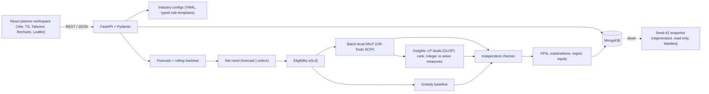

# SahiSupply architecture

> Database override: the PRD names SQLite; this implementation uses **MongoDB** as the primary database
> (per the engineering brief). Everything else follows the PRD's design.

## Components



## Run flow (`app/services/planner.py::run_plan`)

1. Validate the request (Pydantic, rule toggles resolved against the module config).
2. Load the dataset from MongoDB (or the labelled snapshot) and apply the scenario (`app/scenarios`).
3. Forecast (cached per demand-history fingerprint) and compute net need (`app/inventory/net_need.py`).
4. Build the `PlanningProblem` and its SHA-256 **fingerprint** over every scenario-applied input and rule.
5. Build eligibility, then solve the MILP (10 s limit, 0.1% gap) and the greedy baseline on the same object.
6. Run the independent checker on both plans with the fingerprint and the displayed totals.
7. Rules-off diagnostic, optional equity comparison, insights, regret (non-S0), explanations.
8. Store the run document in `optimization_runs` (or in memory, flagged `persisted: false`).

A planner override re-runs steps 6-8 on the edited plan from the stored raw inputs.

## Code map

| Area | Path | Notes |
|---|---|---|
| Settings | `backend/app/config.py` | `MONGODB_URI`, `MONGODB_DB`, `APP_ENV`, CORS, solver limit |
| Database | `backend/app/database/` | connection, JSON-schema validators + indexes, repositories |
| Synthetic data | `backend/app/data/` | catalog + deterministic generator |
| Configs | `configs/*.yaml`, `backend/app/modules/` | strict schema, fixed template registry, rule resolution |
| Forecasting | `backend/app/forecasting/` | seasonal naive, MA28, HistGradientBoosting (recursive 7-day blocks), backtest |
| Inventory | `backend/app/inventory/` | planning problem, eligibility, net need |
| Optimization | `backend/app/optimization/` | `model.py` MILP, `baseline.py`, `checker.py`, `explanations.py`, `insights.py`, `regret.py` |
| Scenarios | `backend/app/scenarios/definitions.py` | S0-S4 as explicit dataset changes |
| Services | `backend/app/services/` | orchestration, KPIs, overrides, run store, read views |
| API | `backend/app/api/` | routers; consistent `{data, meta}` / `{error}` envelopes |
| Frontend | `frontend/src/` | `pages/`, `components/`, `hooks/usePlanner.tsx` (workspace state), `api/client.ts` |

## Optimization model

Decision variables exist only for eligible batch-outlet pairs with positive need:

```
min  sum c(b,d) x(b,d) + sum pi(p) u(d,p) + eps * sum r_b x(b,d)  [+ 100 pi s(d,p) with the equity floor]
s.t. sum_d x(b,d) <= I_b                          batch stock
     sum_b x(b,d) + u(d,p) = q(d,p)               need balance (never ship beyond need)
     sum v_p x <= OutCap_w, InCap_d, ColdCap_d, RouteCap_wd
     x integer >= 0, u >= 0
pi(p) = class weight * (unit gross margin + s); s = 1.5 * max unit delivery cost + 1 (policy, not money)
eps   = 0.01 * min unit cost / max r_b  -> FEFO never outweighs > 1% of the smallest unit cost
c(b,d) = route cost per litre * unit volume * (1.6 if non-ambient)
```

Shortage variables keep every valid input feasible. Statuses other than OPTIMAL/FEASIBLE produce **no**
plan; the run is stored as `SOLVER_FAILED` and the UI shows only the labelled baseline.

## Independence of the checker

`app/optimization/checker.py` imports nothing from the optimizer, baseline or eligibility builder. It reads
the plain `raw_inputs()` snapshot, recomputes shelf life from ISO dates with its own arithmetic, restates
the cost formula, and verifies integrality, stock, need, every capacity, warehouse/route status, shelf-life
and storage rules, the fingerprint and the displayed totals. Insight values are re-derived from the two
plans' raw lines (`verify_insight`).

## MongoDB collections

`modules`, `warehouses` (GeoJSON + 2dsphere), `outlets` (GeoJSON + 2dsphere), `products`, `batches`,
`demand_history`, `open_orders`, `outlet_inventory`, `routes` (`variant`: contested / uncontested),
`calendars`, `dataset_meta`, `optimization_runs`, `plan_overrides`, `forecast_runs`. Unique compound
indexes on `(module, <entity id>)`; strict JSON-schema validators on batches, routes, warehouses, outlets,
products, runs and overrides. Calculation logic stays in Python; MongoDB stores data and history only.

## Scaling notes

Demo size (5 x 12 x 15) solves in ~0.1 s; the 10 x 48 x 30 stress instance solved OPTIMAL in ~1 s
(see `validation/results.md` / `tests/test_harness.py`). The PRD's regional design (LP split of shared
capacity, per-group MILPs, checker on the merged plan) is not implemented.
